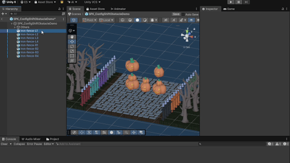
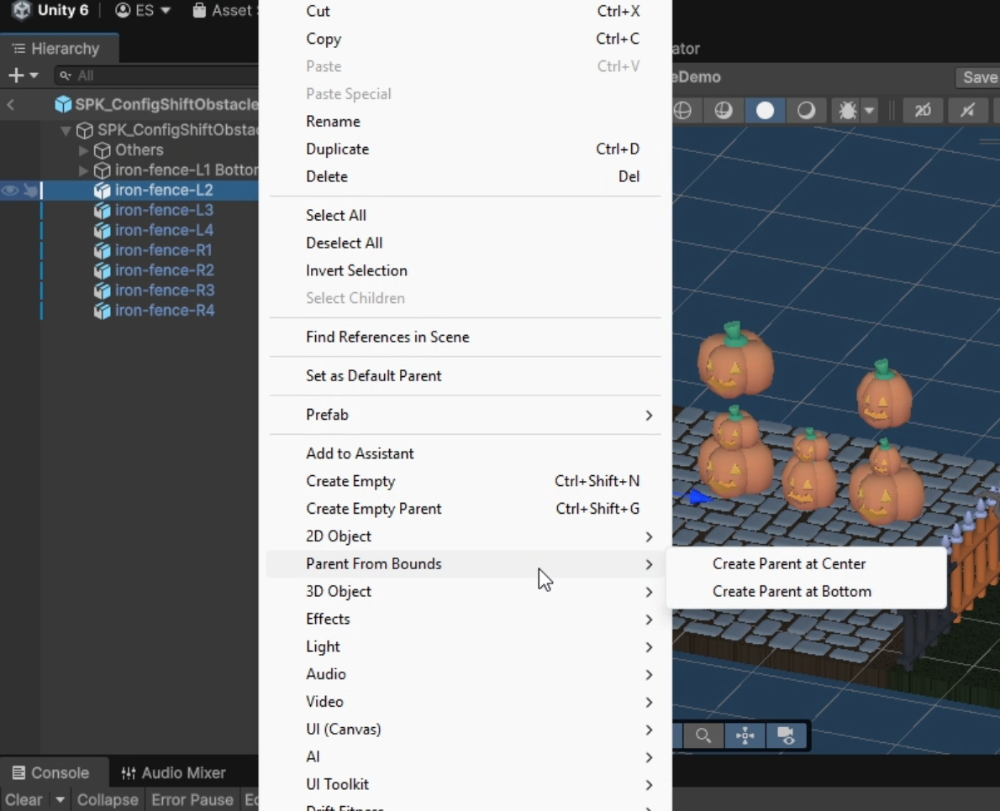
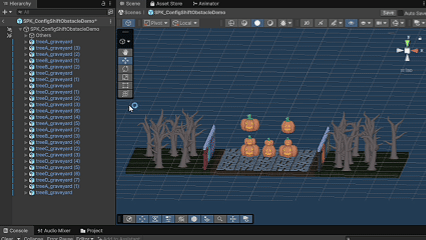
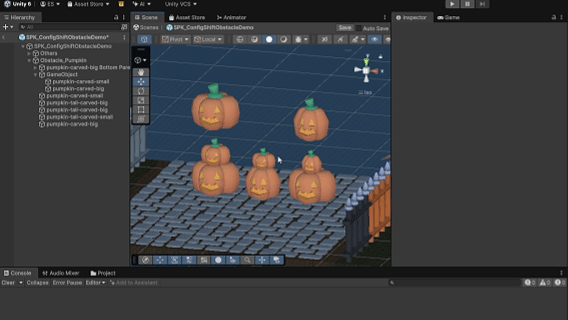

# Parent From Bounds

Parent From Bounds creates a new parent for selected Unity GameObjects at the center or bottom of their combined bounds while preserving their world-space placement.



## Installation

Copy `Editor/ParentFromBounds.cs` into your Unity project and keep it inside an `Editor` folder, for example:

```text
Assets/Editor/ParentFromBounds.cs
```

No dependencies or package setup are required.

## Usage

Select one or more GameObjects in the Hierarchy, then run one of the commands from Unity's GameObject menu:

```text
GameObject > Parent From Bounds > Create Parent at Center
GameObject > Parent From Bounds > Create Parent at Bottom
```



### Create Parent at Center

The new parent is placed at the center of the selected objects' combined bounds.



### Create Parent at Bottom

The new parent is placed at the bottom-center of the selected objects' combined bounds.



## Behavior

- Multiple selected objects are grouped under one new parent.
- If both a parent and its child are selected, only the top-level selected parent is processed.
- If selected top-level objects have different parents but are in the same scene, the tool creates a new scene-root parent and regroups them.
- If selected top-level objects span multiple scenes, the tool does nothing and logs a warning.
- Inactive selected objects and inactive child objects are included in bounds calculations.
- Renderer bounds are used first.
- 3D Collider bounds are used when a selected root or subtree has no eligible Renderer bounds.
- Transform position is used when no eligible Renderer or 3D Collider bounds exist.
- Selected objects keep their world-space transforms when reparented.
- Each operation is registered with Unity Undo.

## Limitations

- Collider2D is not supported.
- Disabled Renderers and disabled Colliders are ignored.
- ParticleSystemRenderer bounds are ignored.
- Cross-scene selection is not supported.

## Compatibility

Tested with Unity `6000.3.15f1`.

## License

This project is available under the MIT License. See [LICENSE](LICENSE).